# SkillSphere — System Architecture & Sequence Diagrams

This document outlines the **System Architecture** and **End-to-End Sequence Diagram** for **SkillSphere** (Campus Skill Exchange Marketplace for College of Engineering Chengannur), formatted in the exact architectural and sequence style of the provided reference diagrams.

---

## 🏗️ 1. SkillSphere System Architecture

```mermaid
flowchart TD
    subgraph L1["1 User layer [Actors & Campus Stakeholders]"]
        style L1 fill:#FAF8F5,stroke:#E8E2D8,stroke-width:1.5px
        A1["Student Buyer<br/><b>@ceconline.edu Client</b><br/><small>Searches skills, funds escrow</small>"]
        A2["Student Provider<br/><b>Peer Freelancer</b><br/><small>Delivers work, earns campus payouts</small>"]
        A3["Campus Administrator<br/><b>admin@ceconline.edu</b><br/><small>Listing approval, dispute escalation</small>"]
        A4["Peer Reviewer<br/><b>Verified Order Client</b><br/><small>Rates work, feeds VADER NLP engine</small>"]
    end

    subgraph L2["2 Presentation layer [React 18 + Vite + Tailwind CSS]"]
        style L2 fill:#EEF8F2,stroke:#D3EADB,stroke-width:1.5px
        P1["Semantic Search & Catalog<br/><b>NL Query & Category Filters</b><br/><small>Cosine relevance score badges</small>"]
        P2["Escrow & Order Tracker<br/><b>Multi-State Lifecycle View</b><br/><small>Pending → Accepted → Delivered → Completed</small>"]
        P3["Student Portfolio Hub<br/><b>Showcase & Verified Reviews</b><br/><small>Project tags, image galleries, NLP badges</small>"]
        P4["Peer Chat & Notifications<br/><b>Direct Messaging & Bell</b><br/><small>Axios interceptor dual-token refresh</small>"]
    end

    subgraph L3["3 Application layer [Core modules, FastAPI & Python 3.11]"]
        style L3 fill:#F1F2FA,stroke:#D9DCF2,stroke-width:1.5px
        direction TB
        M1["Auth & Rate Guard<br/><b>JWT & Sliding-Window IP Limit</b>"]
        M2["Semantic AI Search<br/><b>Sublinear TF-IDF Engine</b>"]
        M3["Order State Machine<br/><b>Milestone & Delivery State</b>"]
        M4["Magic-Byte File Validator<br/><b>Binary Signature Check</b>"]
        M5["Razorpay Escrow Handler<br/><b>HMAC-SHA256 Signature Check</b>"]
        M6["VADER NLP Sentiment Engine<br/><b>Offline Lexicon Intensity</b>"]

        M1 --> M2 --> M3
        M3 -->|File Attachments| M4
        M3 -->|Payment Settlement| M5
        M3 -->|Completed Order| M6
    end

    subgraph L4["4 Data and storage layer [Persistence & In-Memory State]"]
        style L4 fill:#FAF1EB,stroke:#F2DDD0,stroke-width:1.5px
        D1["PostgreSQL 15<br/><b>AsyncPG + SQLAlchemy 2.0</b><br/><small>Users, Services, Orders, Reviews, Portfolios</small>"]
        D2["Redis 7 Cache<br/><b>In-Memory Fast Store</b><br/><small>Sliding-window rate limits & token cache</small>"]
        D3["Local Vector Corpus<br/><b>TF-IDF Vocabulary Index</b><br/><small>Synonyms across 7 campus domains</small>"]
        D4["Static File Vault<br/><b>Local Encrypted Directory</b><br/><small>User avatars, deliverables, banners</small>"]
    end

    subgraph L5["5 Infrastructure layer [Dockerized Campus Runtime]"]
        style L5 fill:#FAEDF2,stroke:#F3D7E3,stroke-width:1.5px
        I1["Docker Compose<br/><b>Bridge Network</b><br/><small>skillsphere_network isolation</small>"]
        I2["FastAPI Container<br/><b>Uvicorn ASGI Engine</b><br/><small>Python 3.11-slim (port 8000)</small>"]
        I3["React Client Container<br/><b>Vite Dev / Nginx</b><br/><small>Fast HMR server (port 3000)</small>"]
        I4["PostgreSQL Container<br/><b>Postgres 15 Alpine</b><br/><small>Persistent healthchecked DB</small>"]
    end

    subgraph EXT["External services [Outside the Campus Cluster]"]
        style EXT fill:#F8FAFC,stroke:#94A3B8,stroke-width:1.5px,stroke-dasharray: 5 5
        E1["Razorpay Payment Engine<br/><b>Checkout SDK & Webhooks</b>"]
        E2["Campus Email Edge<br/><b>@ceconline.edu Validation</b>"]
        E3["Browser LocalStorage<br/><b>Axios Interceptor Token Queue</b>"]
    end

    L1 --> L2
    L2 --> L3
    L3 --> L4
    L4 --> L5
    L3 -.-> EXT
```



### Layer Breakdown

| Layer | Responsibility | Key Technologies / Components |
| :--- | :--- | :--- |
| **1. User Layer** | End-users participating in the campus skill exchange ecosystem. | Student Buyer, Student Provider, Campus Admin (`admin@ceconline.edu`), Peer Reviewer |
| **2. Presentation Layer** | Single-page client responsive interface with optimistic updates and live status. | React 18, Vite, Tailwind CSS, Heroicons, Axios response interceptor |
| **3. Application Layer** | Async REST API services, business logic, safety checks, and offline AI processing. | FastAPI, Uvicorn, Pydantic v2, Python-Jose JWT, VADER NLP, TF-IDF Vectorizer |
| **4. Data Layer** | Persistent relational storage, in-memory caching, vector models, and media files. | PostgreSQL 15 (AsyncPG), Redis 7, Local Vector Dictionary, Local Storage Volume |
| **5. Infrastructure Layer** | Containerized reproducible environment with health checks and bridge networking. | Docker Compose, Multi-stage Dockerfiles, Linux Alpine, Nginx Reverse Proxy |
| **External Services** | Gateway and external integration boundaries. | Razorpay Gateway, College Domain Filter (`@ceconline.edu`), LocalStorage Token Queue |

---

## 🔄 2. SkillSphere End-to-End Sequence Diagram

The sequence diagram below models the complete lifecycle of a gig transaction—from natural language discovery and escrow payment to deliverable file validation, buyer acceptance, and offline NLP sentiment review.

```mermaid
sequenceDiagram
    autonumber
    actor Buyer as Student Buyer
    participant Client as React SPA (Vite)
    participant API as FastAPI Gateway
    participant Auth as Security & Rate Limiter
    participant SearchAI as TF-IDF Semantic AI
    participant Escrow as Razorpay Gateway
    actor Seller as Student Provider
    participant SentimentAI as VADER Sentiment AI
    participant DB as PostgreSQL 15

    %% --------------------------------------------------------
    %% Phase 1: Discovery & Semantic Search
    %% --------------------------------------------------------
    rect rgb(240, 246, 255)
        Note over Buyer, DB: 1. Semantic Discovery & AI Search
        Buyer->>Client: Enter query ("help with python assignment")
        Client->>API: GET /api/v1/services/search/semantic?q=python
        API->>Auth: Validate JWT & Sliding Window (10 req/min)
        Auth-->>API: Authorized & Within Rate Quota
        API->>SearchAI: Expand synonyms & compute TF-IDF cosine similarity
        SearchAI->>DB: Query active listings (fallback to ILIKE if cosine=0)
        DB-->>SearchAI: Service catalog records
        SearchAI-->>API: Ranked listings with relevance scores
        API-->>Client: HTTP 200 (Ranked Services JSON)
        Client-->>Buyer: Render listing cards with tags & average ratings
    end

    %% --------------------------------------------------------
    %% Phase 2: Order Placement & Escrow Initialization
    %% --------------------------------------------------------
    rect rgb(254, 242, 242)
        Note over Buyer, DB: 2. Escrow Order Setup
        Buyer->>Client: Click "Order Service" with requirements
        Client->>API: POST /api/v1/orders (requirements, agreed_price)
        API->>DB: INSERT order (status='pending', payment='pending')
        DB-->>API: Created order ID
        API->>Escrow: Create Order (amount_paise, INR, HMAC Secret)
        Escrow-->>API: Return razorpay_order_id & checkout credentials
        API-->>Client: Initialize Razorpay Checkout Modal
        Client->>Buyer: Open payment sheet (UPI / Card / NetBanking)
        Buyer->>Client: Authorize payment via UPI / OTP
    end

    %% --------------------------------------------------------
    %% Phase 3: Payment Verification & Escrow Lock
    %% --------------------------------------------------------
    rect rgb(236, 253, 245)
        Note over Buyer, DB: 3. Escrow Verification & Lock
        Client->>API: POST /api/v1/payments/verify (signature, payment_id)
        critical Verify HMAC Signature
            API->>API: Calculate HMAC-SHA256(order_id | payment_id, SECRET)
        option Signature Valid
            API->>DB: UPDATE orders SET status='accepted', payment_status='paid'
            API->>Seller: In-App Notification: "New Funded Order Accepted!"
            API-->>Client: HTTP 200 (Escrow Locked & Order Active)
        option Signature Mismatch
            API-->>Client: HTTP 400 (Payment Fraud Detected)
        end
    end

    %% --------------------------------------------------------
    %% Phase 4: Collaboration & Deliverable Submission
    %% --------------------------------------------------------
    rect rgb(245, 243, 255)
        Note over Buyer, DB: 4. Deliverable Handover & Inspection
        loop Peer Communication
            Seller->>API: POST /api/v1/chat/messages (spec questions)
            API->>Buyer: Push message to Buyer's chat thread
        end
        Seller->>API: POST /api/v1/orders/{id}/deliver (Upload deliverable)
        API->>API: Magic-Byte Binary Check (Validates FF D8 FF / 89 50 4E 47 / 25 50 44 46)
        API->>DB: UPDATE orders SET status='delivered', actual_delivery=NOW()
        API->>Buyer: Notify Buyer: "Work Submitted for Inspection"
    end

    %% --------------------------------------------------------
    %% Phase 5: Buyer Inspection & Acceptance
    %% --------------------------------------------------------
    rect rgb(255, 251, 235)
        Note over Buyer, DB: 5. Buyer Inspection & Settlement
        alt Revision Requested
            Buyer->>API: POST /api/v1/orders/{id}/revision (Feedback notes)
            API->>Seller: Notify: "Revision Requested" (status='revision')
        else Approved
            Buyer->>API: POST /api/v1/orders/{id}/complete (Approve Deliverable)
            API->>DB: SET status='completed'; Release Escrow (provider.total_earnings += price)
            API-->>Buyer: Order Completed & Funds Credited to Seller
        end
    end

    %% --------------------------------------------------------
    %% Phase 6: Local AI Review Sentiment Analysis
    %% --------------------------------------------------------
    rect rgb(236, 254, 255)
        Note over Buyer, DB: 6. Local AI Sentiment & Feedback
        Buyer->>Client: Submit 5★ review & comment ("Outstanding work, very fast!")
        Client->>API: POST /api/v1/reviews (rating, comment)
        API->>SentimentAI: analyze_sentiment(comment, rating)
        Note over SentimentAI: VADER lexicon parses boosters ("very"), negations ("not bad"), emphasis
        SentimentAI-->>API: {compound_score: +0.88, label: 'positive', summary: 'Overwhelmingly Positive'}
        API->>DB: INSERT reviews, Recalculate provider.average_rating & service.average_rating
        API->>Seller: In-App Notification: "New 5★ Positive Review Posted!"
        API-->>Client: HTTP 201 Created (Review Verified & Live)
    end
```

---

## 🛡️ 3. Key Architectural Decisions (ADR Summary)

1. **Why Async SQLAlchemy with AsyncPG?**
   - Non-blocking I/O ensures hundreds of concurrent student chat queries and order polling requests run concurrently without blocking ASGI threads.
2. **Why 100% Offline Local AI (TF-IDF + VADER)?**
   - **Zero Operating Cost**: Zero third-party cloud LLM API fees for campus operations.
   - **Student Privacy**: Chat deliverables and reviews never leave campus servers.
   - **Sub-millisecond Latency**: Local heuristic evaluations execute in `< 1ms`.
3. **Why Sliding-Window Rate Limiting?**
   - Protects login, registration, and refresh endpoints from campus automated credential brute-forcing while remaining lightweight via in-memory data structures.
4. **Why Magic-Byte Binary Header Validation?**
   - Rejects malicious uploads disguised as images/documents by strictly checking binary signatures (`FF D8 FF`, `89 50 4E 47`, `25 50 44 46`) instead of trusting spoofable client `Content-Type` headers.
